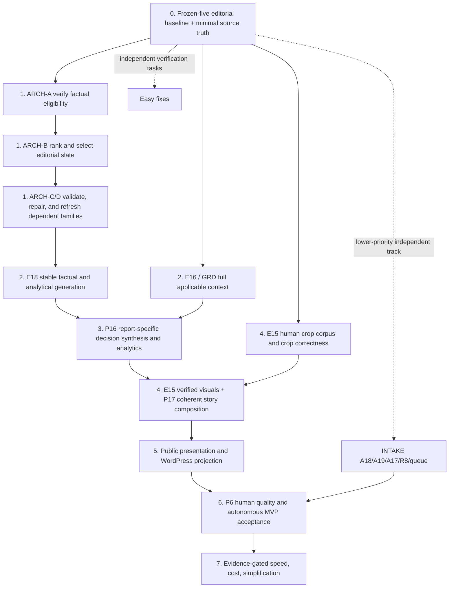

# MarketLense — Intelligence-first implementation roadmap

> **Repository path:** `docs/backlog/implementation-roadmap.md`  
> **Evidence snapshot:** `mbrakker/marketlense`, `main` at `3f05588ce209fa9fd5ae4b53139b07cd55fc1e85` (11 October 2026); implementation state must be rechecked at execution HEAD.  
> **Revision:** Explicit resource and sequencing priority for **intelligence production**, with discovery/acquisition as a lower-priority parallel enablement track; this document is sequencing guidance, not code implementation, test evidence, or a release attestation.  
> **Authority:** `CONSOLIDATED_TODO.md` alone owns statuses. Five `docs/backlog/[A,P,E,R,S]-*.md` workstreams own full requirements and Luna prompts; `docs/backlog/proposal-index.md` owns 109 legacy proposal mappings. **This roadmap owns execution order, not task status.**

## Priority policy — intelligence production before intake expansion

Ship the smallest autonomous MVP that consistently produces source-faithful, analyst-quality intelligence. Sequence work by **factual fidelity → intelligence production quality (evidence selection, insight depth, commercial relevance, decision synthesis) → editorial/visual output quality → autonomous operation → reliability → simplicity → speed/cost**, while repairing defects at their **earliest sensible source**. Avoid treating every proposal as a separate deliverable or implementing speculative fixes without checking the current code.

The current register contains **33 Active, 44 Closed, 14 Deferred, and 3 Excluded** outcomes. The 109 older technical proposals are *implementation slices*; some are already partly or wholly implemented despite historical “Proposal” labels. **Before executing any row:** verify the current HEAD, existing implementation, tests and retained report evidence. If solved, reconcile the technical slice rather than reimplement it. Do not reopen Closed outcomes automatically. Do not turn Deferred or Excluded work into a prerequisite.

- **P0 prerequisite:** incorrect source identity, corrupted evidence, unsafe persistence/side effects, missing measurement needed to judge a fix. **P1 delivery:** materially improves autonomous throughput, report quality or reliability. **P2 later:** bounded optimization or clean-up without proven MVP impact. These are *proposed execution tiers*, not changes to canonical task statuses.
- **Hard dependency:** required interface, trustworthy source evidence, or acceptance input is not yet available. **Quality dependency:** work could be coded earlier, but must not be promoted without independent regression evidence. **Opportunity:** worthwhile only when a measured bottleneck or failure justifies it.
- A phase's **gate** means its dependent work cannot be promoted, not that all independent work must run serially. Parallelize independent preparation, tests and code changes without increasing provider concurrency prematurely.
- Record completion and evidence **only in each canonical owning specification and `CONSOLIDATED_TODO.md`**. This file should be changed only if the critical path, prerequisites or practical execution order changes. Do not duplicate completion flags, task checklists or another status ledger.

### Default scheduling and exception rule

**Primary critical path (first claim on implementation capacity):** `GRD/E16` minimum source truth → **ARCH-A verify** → **ARCH-B rank and select** → **ARCH-C/D consistent downstream facts and repair** → **E18 factual/analytical stability** → **P16 decision-grade synthesis** → **E15/P17 substantive visual storytelling** → **P6 human quality evidence**. Workstream task ownership stays unchanged.

**Secondary enabling track:** `A18` discovery recall, `A19` acquisition mechanisms, `A17` admission, `R8` path hardening, broader queue throughput and route economics. Work on these in parallel *only when capacity does not delay the intelligence critical path*. Do not pursue additional publisher breadth, route coverage, browser automation, form success, or acquisition speed as a substitute for improving the **reports already acquired**. Existing frozen reports and their authoritative evidence are sufficient to exercise the intelligence-critical path.

**Exceptions — upstream fixes take precedence only when demonstrably necessary:** (a) invalid/untrusted source identity or corrupted acquired PDF/evidence would compromise factual output; (b) representative retained reports cannot be read/replayed at all; (c) a reproducible data-loss, unsafe external side-effect, security, or queue-integrity fault prevents safe execution; or (d) the required autonomous-MVP acceptance lane is otherwise blocked after intelligence quality reaches its gate. Fix the smallest root cause. Document the exact dependency and proof, and return to intelligence work as soon as the blocker is cleared. **Being earlier in the pipeline does not automatically make discovery/acquisition higher priority.**

**Do not interpret parallel as equal resourcing:** Where engineering time is constrained, protect the ARCH → E18 → P16 → E15/P17 milestones first. Discovery/acquisition backlog completion is not a prerequisite for developing, benchmarking, or promoting intelligence generation on already retained sources. Full autonomous deployment still requires trustworthy new-source intake and operational safety.

## First priority: a shared, verified evidence slate

**ARCH-A/B is the first major product-quality implementation, not a Phase-3/4 enhancement.** Start from the existing acquired frozen-five reports; do not wait for discovery, mailbox, WordPress, throughput, or visual UX backlog completion to build/test the evidence slate. Those are separate parallel MVP tracks.

1. **Minimal hard preconditions:** verify the *actual* current-HEAD gaps for `GRD-01` collision-safe identities, `GRD-02` authoritative source versus generated narrative, `GRD-05` support grade, `GRD-07` numeric observation binding, `GRD-09` recommendation premises and the necessary `E16` methods/applicability qualifiers. Existing validators and retained evidence are the starting point; fix only blockers demonstrated by focused fixtures. Freeze baseline output/selection IDs and a representative five-report quality comparison before promotion. Mandatory final validations remain in force.
2. **Verify (`ARCH-A`, A21 owner):** expose one versioned, source-root-bound candidate-eligibility view from existing fidelity results. Invalid, ambiguous and stale support cannot enter selection. Verification is factual eligibility, not commercial ranking; do not equate evidence-pack completeness with factual certainty.
3. **Rank (`ARCH-B`, P17 owner):** extend the existing editorial plan with source-bound prioritization across independent themes, importance, commercial implications, novelty and counter-signals. Preserve model semantic judgment for significance rather than replacing it with brittle deterministic heuristics. `ART-06` report-breadth handling is a scoped input/prerequisite where applicable.
4. **Select (`ARCH-B`, same owner):** choose one diverse, nonredundant, report-specific slate and compact approved reserve. Methods, population/period, conflicting evidence and scope caveats remain mandatory constraints, not optional low-ranked content. Persist exact IDs and ranking/selection lineage; downstream families consume the same slate.
5. **Protect consumers (`ARCH-C/D`, A21/E13 owners):** check newly generated material claims before dependent prose, substitute only verified reserves, and invalidate/regenerate genuinely stale downstream families after promoted repairs. Retain final grounding/readiness rather than treating upstream checks as publication approval.

**Promotion proof:** On the unchanged frozen five, inspect the *selected evidence and rendered report-specific meaning* (not just schema validity), important themes, counter-signals, factual error rate, unsupported advice, repeated claims, P6 editorial preference, first-pass readiness, calls/cost and latency. Compare with the pre-change baseline at exact source/model/policy identities. Require a material improvement in evidence choice, analytical depth or commercial usefulness where the architecture changes editorial behavior; at minimum, factual fidelity, breadth, reliability and human quality must not regress. Roll back or stop if the claim of improvement is not independently supported.

### Intelligence-first dependency map

**Interpretation:** The heavy line of execution runs through report intelligence, not through wider publisher coverage. Intake is upstream of **future source acquisition**, but not of improving analytical output from already-frozen acquired reports. `E15` visual correctness must precede publishing a figure; textual evidence selection should not wait for crop or new-report discovery completion. Only *verified* blocking defects elevate an intake task above intelligence delivery.

## Phase 0 — Establish only the baselines and source truth needed for intelligence work

**Start immediately.** Keep this a short prerequisite tranche, not an invitation to complete discovery, provider readiness or all grounding items before ARCH-A/B. Independent preparation should not consume the first execution capacity.

| Owner / slice | Deliverable | Required before |
| --- | --- | --- |
| **E18.1** | Frozen-five repeatability baseline: repeated generation *and* fixed-input validation, separating factual drift from model-verdict variance. | Any E18.2–E18.4 behavior changes; use provider-free audits before bounded live calls. |
| **GRD-01/02/05/07/09 + E16 (minimal)** | Confirm or fix identity collisions, authoritative source roots, support grades, atomic metric/period/cohort bindings and fact-level applicability needed for trusted candidate eligibility. Reuse the existing fidelity validator; do not turn this into a broad redesign. | `ARCH-A` factual eligibility; only the affected first-slate facts/contracts are hard blockers. |
| **ARCH-A/B baseline** | Pin current editorial-plan candidate/selected IDs, theme/counter-signal coverage, summary/insight differences and P6 rubric on unchanged five-report evidence before behavior changes. | Prove selection improvement without dropping relevant or qualifying facts. |
| **P6 (rubric preparation)** | Resolve the conflicting human-review protocols, establish exact source/render identities and independent rubric; collect missing human reviews later. | Human editorial acceptance, and promotion of P16/P17 quality changes. |

**Optional read-only parallel preparation (not blocking ARCH-A/B):** `E17.1` stage-level usage, input/output/cache, latency and quality baseline may start when capacity is available; no semantic simplification is authorized by its measurement.

**Gate 0 (intelligence prerequisite):** Minimal trustworthy evidence contracts and comparable existing selection outputs are available for ARCH-A/B; compatible pinned sources and criteria exist; no new provider or WordPress writes are hidden in a measurement step. Where human labels or live credentials are unavailable, mark the gate unverified rather than manufacturing approval.

## Phase 1 — Verify → rank → select; protect downstream intelligence (highest implementation priority)

**1a — Verify / ARCH-A (A21).** After the *minimal* Phase-0 GRD/E16 prerequisites, reuse the existing evidence fidelity and source-reference registry to create an approved evidence candidate view. Preserve exact claim/source IDs, qualified support status, caveats, periods, population and lineage. Unsupported and unresolved material facts do not silently become eligible.

**1b — Rank and select / ARCH-B (P17).** Extend the existing editorial plan rather than add a new ranking service. Rank eligible facts for importance and commercial decision value using semantic judgment where needed; select a diverse portfolio spanning themes, quantified evidence and counter-signals, plus a small supported reserve. Do **not** drop methodology/caveats during ranking, impose a universal item count or collapse independent summary and insight calls just to save tokens.

**1c — Verify downstream / ARCH-C/D (A21/E13).** Early reject invalid newly created material claims before Expert/LinkedIn/cover/caption dependent calls; use approved alternatives, bounded local repair or abstention. Where a promoted patch changes a factual premise, invalidate and rebuild only truly dependent generated families using existing artifact lineage and atomic rollback. Preserve comprehensive final validation.

**Gate 1 — verified shared slate:** Source-root-fidelity-positive and adversarial-negative fixtures pass, the fixed five-report comparison retains or improves factual fidelity, important themes/counter-signals, editorial preference and first-pass readiness, and downstream texts cannot retain stale repaired facts. If a source-integrity prerequisite is not yet correct, do not label the slate verified; fix that upstream prerequisite first. A/B should begin from already acquired frozen reports without waiting for A18/A19 to complete.

## Phase 2 — Stabilize intelligence facts, methodology, generation, and validation

**Higher priority than intake expansion.** The minimal GRD/E16 prerequisites for ARCH-A were verified in Phase 0. Close any *additional demonstrated* claim, scope, methodology and validation defects at their upstream owner before adding downstream prompting patches. Treat E18.1 as a baseline that can start in Phase 0; only implement E18.2–4 if the retained comparison proves the cause.

1. **A21 / broader grounding (only where needed):** `GRD-01` collision-safe registry → `GRD-02` authoritative source support distinct from generated narrative → `GRD-03/05/06` page-set semantics, support-grade provenance and full source fragments → `GRD-07` atomic numeric observation/label/cohort/period binding. Add `GRD-08` speaker/exact-quote support and `GRD-09` factual premises in advice where affected. `GRD-10` carries approved root lineage through cross-report joins. **Fail closed** on conflicting IDs, value swaps, uncertain page recovery and invented premises.
2. **E16 methodology and time:** Typed source-linked methods, populations, periods, caveats, unknown/conflict/abstention and applicability follow approved evidence roots. `ANA-01` lossless metric projection consumes existing supported context (and GRD-07 for new atomic observations); `ANA-10` separates publication, observation and projection times; `GRD-10` protects joined evidence identity. Do not invent precision from free-text limitations.

3. **E18.1 baseline first**, then **E18.2** only for reproduced generation factual drift and **E18.3** only for observed unstable thematic selection *remaining after ARCH-A/B*. Preserve commercial reasoning in the LLM; use deterministic protections only where semantically equivalent or contractually required.
4. **A21 / VER foundation:** confirm `VER-01` exhaustive requested-item verdicts and `VER-04` retry semantics → `VER-02` malformed/unavailable judgment classification → `VER-03` mandatory-rule execution proof → `VER-07` persisted readiness consistency and `VER-09` cheap prerequisite sequencing. Run `VER-05` adversarial corpus; `VER-06` blinded human false-accept/reject calibration is an evidence gate, not a new approval service.
5. **Consume Phase-1 ARCH-A/B/C/D, do not rebuild it.** Enforce existing `ART-04` family policy. E18.2/3 behavior work should operate on the same eligible evidence slate and distinguish source/input selection variance from model generation variance. Keep verified inputs and optional human inference separate.
6. **E13** measure actual bounded candidate-repair promotion effectiveness, never relax rollback/provenance to improve pass rates. **E18.4** can then address proved fixed-input semantic-verdict variance, integrate scoped repair and compare the same frozen five reports, including previously failed and successful members. Mark false accepts and false rejects separately.
7. **A21** may run provider-free full-queue replay and targeted failed-case tests now; the representative live end-to-end acceptance remains Phase 6.

**Gate 2 — reliable intelligence:** Factual bindings survive generations/repairs; required rule coverage and failed judgments are explicit; a repaired artifact cannot carry stale dependent text. No claimed stability gain based only on schemas compiling or token counts falling.
**Source-truth acceptance:** Each material source claim resolves to authoritative evidence with correct numeric relationships and applicability; unverified relationships remain qualified or held. Visual semantic acceptance is separately enforced in Phase 4.
## Phase 3 — Produce commercially relevant decision-grade intelligence

**Keep intelligence creation ahead of publisher and route expansion.** Analytical depth, report-specific implications, trade-offs, uncertainty and the best source evidence determine the usefulness of MarketLense. Do not prioritize additional acquired reports while existing reports produce weak or generic advice.

**E6 / ANA-05 → ANA-06 preparation:** Check vector validity and model compatibility, then pin a zero-provider semantic benchmark **before** altering cross-report retrieval or claiming improved ranking. This is independent of ARCH-A/B source-fact selection.

- **E6 → ANA-04/07/08/09:** after vector-integrity and task-relevant offline benchmarks, measure request-specific retrieval, item-level Signal support, independent comparable agreement and balanced context budgets. `ANA-07/08` also depend on approved claim lineage and context from Phases 0/2. `ANA-03` publisher-diversity scoring already appears corrected in source and should be **verified/reconciled**, not reimplemented without evidence.
- **E14** build read-only category-fit calibration from retained compatible decisions. Proposals do not automatically change taxonomies or rejection thresholds.
- **P16** freeze the consultancy-quality baseline early; implement a source-bound decision-synthesis family only after ARCH-A/B-approved eligibility/priorities, E16/GRD factual premises and adequate editorial-plan stability are available. Project one approved synthesis into Summary, Decision Brief, Expert View and other purposeful surfaces. Require explicit conditions, trade-offs, counterevidence and uncertainty; validate with blinded human comparison.
- **P8** may design concise approved public evidence/methodology contracts now, but promote rendering only once E16 and lineage are truthful. **P17** can baseline existing layouts now; composition behavior belongs to Phase 4.

**Gate 3 — decision-grade intelligence:** Decision guidance is report-specific, commercially relevant and sourced where factual. Cross-report Signal evidence is item-level and comparable; weak input produces qualified output or abstention rather than generic advice.

## Phase 4 — Prove visual completeness and assemble a compelling report-specific story

Visual accuracy and narrative hierarchy belong to **intelligence quality**, not optional website polish. `E15/CROP-01` human labels may start in parallel with ARCH-A/B, but no unsafe crop may be published. Complete correctness before downstream caption and composition work.

**E15 / CROP-01 prerequisite:** Establish the human-labelled crop corpus, semantic completeness rubric and separate candidate-recall baseline before promoting CROP-04/06/07/08/09 or claiming visual-quality improvement.

1. **E15 visual completeness:** `CROP-01` labels → validate existing `CROP-05` coordinate/invalid-bbox corrections → `CROP-04/06` localization and protected semantic bbox → `CROP-07/08` outward source-bbox repair and **rejecting** chart/table completeness → `CROP-09` final-DPI/QA-proof consistency on every reuse/fallback → `CROP-02/03/10` useful-selection and panel/continuation coverage. Some strict-publication provenance checks are already recorded; human semantic completeness still requires independent proof.

2. **P17** implement a small finite, source-aware composition plan using the shared ARCH-B slate, validated P16 synthesis and E15-approved visuals. Make figure caption evidence/crop alignment (`ARCH-G`) authoritative; do not create facts in the renderer. Blinded desktop/mobile reading and accessibility comparisons precede promotion.

**Gate 4 — analyst-quality report:** Human review finds the selected evidence significant, the synthesis useful, and figures visually complete, legible and factually compatible with captions. Reports with no safe visual omit it rather than publishing clipped or decorative evidence. No new facts are generated in WordPress.

## Phase 5 — Project intelligence to public surfaces and instrument delivery

**Downstream of substantive editorial quality.** Maintain WordPress correctness and visibility without turning routine site enhancement into the primary engineering program while intelligence quality remains substandard.

1. **P8** publish only approved evidence/methodology and deterministic related-content links; omissions on incomplete support must be explicit and safe.
2. **P2** bounded/redacted WordPress event contract **before** closing dependent **P4** intake and **P10** correlated render telemetry. Hosted route smoke must demonstrate correct private persistence, visitor-safe failure screens and correlation; keep the sandbox's intentional HTTP configuration.
3. **P5** hosted responsive navigation/search checks can run early as independent verification; repair only observed issues. **P7** first correct browser performance measurement, then optimize against real hosted results *after* materially changing P17 layouts. Do not mistake HTTP probes for Core Web Vitals.
4. **R6** can add private, bounded, metadata-only reduction reports as an independent low-risk lane; do not reconstruct dropped sensitive log payloads. **S4** shortcode cleanup waits unless an observed boundary defect blocks public correctness.

**Gate 5 — publication presentation:** Source-linked, accessible, mobile-compatible and WordPress-parity-compliant output; bounded private errors; safe intake; hosted performance assessed using the right measurement technique.

## Parallel enabling track — Discovery, acquisition, queue and Windows paths (lower implementation priority)

**Explicitly subordinate to the intelligence-production critical path.** This track enables new-source volume and fully unattended production, but it is **not Phase 0 or a prerequisite for ARCH-A/B/E18/P16/P17 on the retained frozen reports**. Do not interpret “upstream” as “implement first”: the upstream-first principle applies **within a defect's dependency chain**. Continue only bounded, independent work while the intelligence team has capacity, unless a concrete source-fidelity, data-loss/security or execution blocker meets the exception rule above.

This lane is upstream of *fresh autonomous report intake* but not a prerequisite for improving ARCH-A/B, E18, P16, E15 or P17 on previously acquired frozen reports. Implement only still-open gaps; a number of A19 and A21 slices have scoped fixes already recorded.

1. **A18 discovery truth and qualified handoff (after intelligence capacity is protected).** `DISC-01` baseline → `DISC-02/03/09` high-recall triage/host identity/card union and `DISC-05` first-run completeness → `DISC-04` separate observed/qualified decision state → `DISC-06/10` executable deferred and incomplete-model recovery → `DISC-07/08` report-local evidence/qualified deduplication → `SYS-07` lossless qualification context to acquisition. `DISC-04` is a **hard prerequisite** for durable deferred recovery and re-screening. Fix the discovery candidate before reclassifying the same report again downstream.
2. **A19 verified report artifact.** `ACQ-01` submission identity and `ACQ-05` exact signed-link semantics → metadata-first `ACQ-04`, structural PDF acceptance `ACQ-06` and bounded candidate continuation `ACQ-08` → mailbox selection `ACQ-03`, durable polling `ACQ-09`, and mechanism economics `ACQ-10`. Confirm recorded fixes for `ACQ-02` read-only UID IMAP and `ACQ-07` ZIP ceilings instead of replacing them. Every route must converge on the **same verified, ingest-compatible artifact**; route success cannot precede local verification and required archive completion.
3. **A21 queue correctness before concurrency.** Establish current `SYS-01` effective config propagation and `SYS-02` lease ownership; only then enable `SYS-03` maintenance queues or materially widen `ING-01` workers. Recheck the already-reported `CODE-01/02/03/09` queue/outbox/idempotency corrections and `VER-04` retry propagation. Prove crash/replay convergence (`SYS-04/05/08`) before claiming fully unattended operation. `ING-09` global provider-cap correctness under **A15** precedes concurrency expansion.
4. **R8 path safety at earliest write points.** Progress `PATH-01` mailbox and `PATH-02` browser → `PATH-03` candidate/OCR → `PATH-04` crop → `PATH-05` cover. These can be tested alongside each corresponding pipeline boundary, but preserve persisted file IDs, lineage, reopen/readback and deterministic cache behavior. `PATH-06` residual inventory is optional after the measured P1 fixes. Static path risk is not evidence of a reproduced Windows failure.
5. **A17 admission** runs an evidence-only proposal after valid discovery/admission funnels and report outcomes exist; don't tighten admission heuristics to make reliability numbers look better. `ING-03/04/05` OCR admission, selective recovery and checkpoint reuse are considered as source-specific needs, with upstream cached-text integrity (`ING-02/06`) confirmed first.

**Intake release gate (not an intelligence development gate):** Discovery decisions are explainable and recoverable; acquisition hands over a verified PDF or an explicit bounded failure; config, lease and path identity survive a retry. Demonstrate lossless qualification→route handoff and representative direct/mailbox/browser cases before celebrating downstream processing success.

**Work selection within intake:** Repair a demonstrated invalid source, broken verified-artifact identity, dangerous queue/lease condition or unrecoverable representative-report readback before throughput and publisher breadth. Defer broad publisher recall maximization, route-coverage expansion, browser-agent convenience and admission optimization until they can be justified by actual source diversity or autonomous-MVP acceptance gaps.

**A18 / DISC-01 preparation (intake track only):** Independent, hash-pinned publisher/discovery recall corpus with false-rejection evidence, required for the later intake triage changes but not for intelligence selection.

## Phase 6 — Independently prove intelligence quality and autonomous completion

**Separate product acceptance from intake readiness.** Human evaluation of existing, frozen reports is a primary quality release gate; no need to finish all A18/A19 improvements before conducting it. Unattended acquisition and publication readiness require a second, explicit end-to-end gate. Neither substitutes for the other.

- **A21:** execute an unchanged stratified full-cohort replay *on one exact tested HEAD*, retaining first attempt versus internally repaired/externally retried/operator intervention, failures/abstentions, costs, readback and replay. Use the 20-report retained baseline and selected-four regression as historical comparisons, **never** combine different revisions into a synthetic full pass. Independently prove the discovery/acquisition/front-to-back lane under explicit sandbox approval.
- **P6:** complete the independently attributed **15-report** blind editorial acceptance (three retained five-report groups). Require actual reviewed artifact hashes and publishability decisions. E15 independently owns visually complete publication crop acceptance. Neither automated verifier scores nor a successful queue run substitute for human editorial/visual evidence.
- **A20 / E10 / R2:** verify the selected run profile, current price-card attestation and required architecture checks before relevant live/provider/mutating runs, without using these as a blanket blocker for offline ARCH-A/B. Extend the existing clean-room capability doctor to prove readiness for the chosen production/sandbox profile. **R7:** execute isolated full-state backup/restore/resume drill against the stated objectives. **R3:** produce attributable exact-commit service-quality coverage and retain the passing baseline.
- **R1:** surface exact-tested-HEAD evidence in the PR/release review, including status, artifact link, coverage limits and approval. Validate manual and separately opt-in `autonomous_mvp` policy only through the existing canonical publication ledger; **do not infer permission for unattended public writes** from a feature toggle.

**Gate 6a — intelligence acceptance:** Independently reviewed reports meet the retained P6 editorial and E15 visual requirements, with sound evidence selection, analysis specificity, commercial applicability and factual support. A passing intake success rate cannot waive this gate.

**Gate 6b — autonomous MVP:** representative report quality and first-attempt results meet explicitly retained criteria; unrecovered failures remain observable/quarantined; required disaster recovery is proven; publication policy and WordPress readback are correct. An unverified gate means *not ready*, not a silent downgraded pass.

**Optional independent preparation:** `A21` measurement preparation: freeze stratified cohort and first-attempt/repair/intervention definitions; reuse A18, P6 and retained cohorts where identities permit. This can start early, but does not displace ARCH-A/B or P16 implementation.

## Phase 7 — Improve cost, parallelism and simplify only after intelligence-quality proof

- **E12** add pre-category checkpoint recovery only if compatible identity and retained category-only replay show worthwhile reliability/cost impact; avoid unnecessary checkpoint infrastructure. This is independent of the source-fidelity and insight-quality milestones.
- **E17:** begin measured work at E17.1 in Phase 0; promote subsequent slices in source-protecting order: **E17.2** output/semantic-verdict efficiency (after verified correctness) → **E17.3** task-specific input evidence projections (after stable provenance and editorial usage) → **E17.4** provider-cache economics with real supported controls → **E17.5** eliminate only proven redundant semantic calls. Compare *quality, first-pass reliability, total calls/tokens/cache economics, wall-clock time and total cost* on the unchanged frozen five.
- **A15 / ING-09 → A21 / ING-01:** verify global model concurrency and queue lease safety **before** increasing workers. Tune throughput only with representative wall-clock and quality measurements. `ING-07` fail-fast scheduling and `ART-01/03` reuse/projections may be independent focused optimizations after correctness gates, not excuses for a new DAG framework.
- **A17** use complete admitted/rejected cohort evidence to propose (not automatically enact) admission-threshold changes. **S3** inspect the visual-heuristics boundary and choose **no change needed** if the complexity/coupling benefit is not material. **S4** may simplify shortcode ownership only behind stable hooks and proven output equivalence.
- **ARCH-H/I** remain P2 investigations: replace validation or editorial passes *only* when identical-cohort factual/editorial output proves equivalence. Keep Deferred/Excluded architecture ideas deferred unless a measured MVP blocker emerges.

**Gate 7:** Improvements are promoted only when measured end-to-end gains coexist with non-regressed factual fidelity, commercial insight depth, autonomous completion and cost controls.

## Easy fixes — no unresolved backlog dependency and low production risk

These are **parallel spare-capacity candidates**, not a mandatory P0 queue and never substitutes for ARCH-A/B/E18/P16/P17. Order by expected value and isolation. “No dependency” means **no unresolved task-level code dependency**; ordinary source inspection, fixture availability and focused tests still apply. Reassess each on current HEAD before assigning Luna. Do not launch costly live calls as an alleged easy fix.

| Candidate | Type / effort | Why independent and low risk | Focused completion proof |
| --- | --- | --- | --- |
| **A8** retained model-call replay comparison | P1; medium; offline-only | Compares approved retained bundles without provider calls or mutation of production work. | Deterministic compatible/changed/incomplete decisions; 0 provider calls; no false equivalence on missing provenance. |
| **E14** category-fit scorecard | P1; medium; read-only | Analyzes existing retained category outcomes without changing taxonomy, model calls or admission rules. | Comparable-cohort fixtures, explicit unknown attribution, reproducible review-only recommendations. |
| **R6** bounded-log reduction summary | P1; small–medium; read-only | Existing Python bounded-log metadata is already emitted; aggregate **metadata only**, without changing logging behavior. | Fixture-backed counts/top recurring callers; no plaintext/secrets or extra log writes. |
| **R1** PR/release evidence-link surfacing | P1; small–medium; review surface | Existing collector already emits evidence artifacts; expose exact SHA/link/scope, including unavailable status, without changing core gates. | Generated PR/release summary fixtures resolve links and never claim unrun live coverage. |
| **P5** hosted mobile/search/navigation smoke | P1; QA-first | Existing responsive harness; requires a reachable sandbox but no upstream new contracts. Changes only for observed defects. | Actual route/viewport screenshots, keyboard interactions, correct build/host identity; distinguish unavailable hosted tests. |
| **S3** PDF coupling inspection | P2; small investigation | Architectural review can conclude **no change needed**. Do not refactor unrelated crop algorithms. | Document concrete coupling/benefit or close the investigation without code churn. |

### Easiest immediate housekeeping: verify instead of reimplement

The following historical proposal-index labels still warrant **current-HEAD reconciliation**. Direct source inspection at the snapshot shows correction mechanisms already present, but this is *not* a full test pass or parent-outcome closure:

| Proposal | Observed evidence | Action |
| --- | --- | --- |
| `SYS-09` → A21 | Exporter uses a derived `_disposition_status()` rather than an unconditional failure label. | Run exporter regression/retained-fixture tests; record scope and mark the slice implemented if proven. A21 remains open. |
| `ANA-03` → P16 | Source selection retains immutable `base_scores` for diversity rounds. | Confirm full score/reason invariants with shuffled-fixture tests; reconcile the slice, not P16 as a whole. |
| `ART-07` → P17 | Topic normalizer uses Unicode normalization and `isalnum()` plus mark preservation. | Check multilingual/ambiguous-ID and readback fixtures; reconcile the slice if verified. |

Do **not** classify `GRD-01`, `CROP-09`, `ART-05`, `ING-07`, `A19` route changes or persisted `R8` path migrations as easy merely because an older specification says “depends on none”: their factual, visual, concurrency, or storage impact requires stricter verification.

## Coverage of all currently Active canonical owners

Each canonical ID appears in **one primary roadmap home** below. Dependencies may appear earlier across lanes. Being listed in the intake lane does **not** give the item equal scheduling priority with report intelligence, and the technical proposal index remains the authoritative mapping for the 109 legacy implementation slices.

| Primary roadmap home | Canonical owners | Execution treatment |
| --- | --- | --- |
| Phase 0 — targeted source truth and pinned editorial baseline | `A8`, `E6`, `E10`, `R2` | Only necessary source-truth and evaluation setup blocks ARCH-A/B |
| **Phase 1 — verified evidence slate and dependent consistency** | **`A21`, `P17`, `E13`** | **First substantive product-quality milestone; A21/P17/E13 here refer to ARCH-A/B/C/D slices** |
| **Phase 2 — factual, methodological, LLM and verification stability** | **`E16`, `E18`** | **Fix output-causing upstream defects before downstream text patches** |
| **Phase 3 — decision synthesis and analytical relevance** | **`P16`, `E14`** | **Second substantive quality milestone; category calibration is independent** |
| **Phase 4 — complete visuals and narrative composition** | **`E15`** | **E15 gate before selected visual publication; P17 implementation continues from Phase 1** |
| Phase 5 — faithful public projection and operation | `P2`, `P4`, `P5`, `P7`, `P8`, `P10`, `R6` | Downstream UX/operability after intelligence content is strong |
| **Parallel intake (secondary unless hard blocker)** | `A15`, `A17`, `A18`, `A19`, `R8` | New-report acquisition, source readiness and pathway safety; not on the frozen-five intelligence path |
| Phase 6 — human acceptance and end-to-end safety | `A20`, `P6`, `R1`, `R3`, `R7` | Independent quality acceptance first; operational MVP proof separately |
| Phase 7 — measured efficiency/simplification | `E17`, `E12`, `S3`, `S4` | Never sacrifice semantic quality for token, time or architecture reductions |

**Coverage:** 33 unique Active outcomes represented exactly once, as at the cited 11 October 2026 snapshot; phase-level priorities do not rewrite their canonical status or imply a current-HEAD implementation verification.

## How to choose the next actual Luna task

1. **Select from the intelligence critical path by default.** Check today's HEAD and current frozen-report output failures first: eligibility → slate quality → first-pass factual stability → P16 decisions → E15/P17 story. Escalate intake only on a demonstrated exception. Prefer upstream cause over its downstream symptoms.
2. **Fix upstream within the chosen intelligence chain.** Trace only applicable blockers. Follow the phase + exact technical-slice prerequisites, not every item listed in an earlier phase. A benchmark/human labeling task can proceed alongside unrelated code fixes.
3. **Take the smallest coherent vertical slice.** Read the owning workstream specification and its original technical evidence/Luna prompt. Confirm it is not already implemented before writing code.
4. **Verify proportionately.** Reproduce the defect, run focused tests, inspect downstream effects and real reports for semantic changes. Use frozen-five comparisons for material LLM/cost/quality work. Do not claim first-pass, P6 or E15 success from code/tests alone.
5. **Commit and push the proven slice** with accurate updates to canonical owner and evidence/proposal disposition. Reorder this roadmap **only** if a dependency, risk ranking or observed failure Pareto actually changes.

### Highest-priority execution bundle

- **First quality-critical team:** pin the frozen-five existing candidate/slate baseline and verify the minimal `GRD-01/02/05/07/09` and `E16` preconditions; immediately implement ARCH-A, then ARCH-B, each with real-report output inspection. Follow with ARCH-C/D, only on proven dependent-prose/repair gaps.
- **Parallel intelligence team:** Start E18.1 repeatability baseline, E15/CROP-01 human visual labels and P6 rubric preparation without delaying ARCH-A/B; after architecture proof, address measured E18 and P16 findings before broadening intake.
- **Secondary intake team (only spare capacity or documented hard blocker):** A18/DISC-01 recall corpus, A19 artifact verification/qualified handoff and R8 targeted readback. Intake work must not become the default next task while intelligence quality remains below acceptance.

- **Parallel easy-fix team (only spare capacity):** A8 or E14 read-only intelligence measurements; R6/R1 telemetry; reconcile SYS-09/ANA-03/ART-07 instead of reimplementing already-correct behavior.

**No release claim is implied by this roadmap.** The source workstreams remain authoritative for detailed acceptance criteria and checks; future implementation should use their copy/paste Luna prompts rather than attempting all phases in one Codex session.